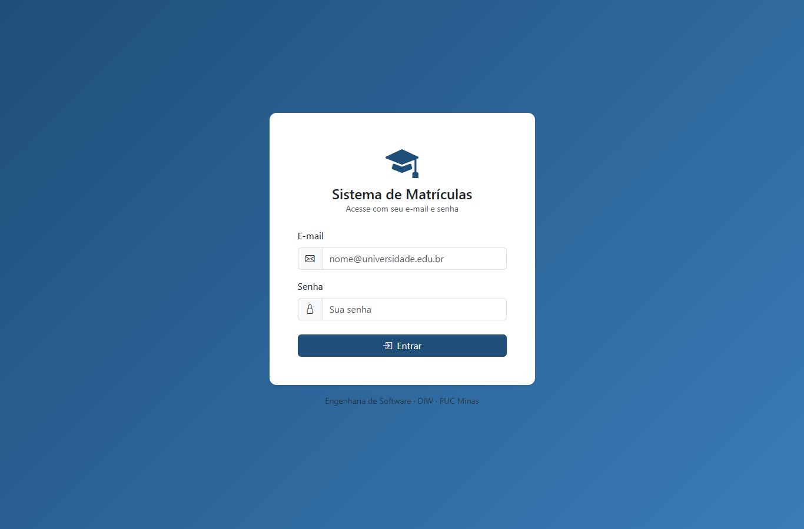
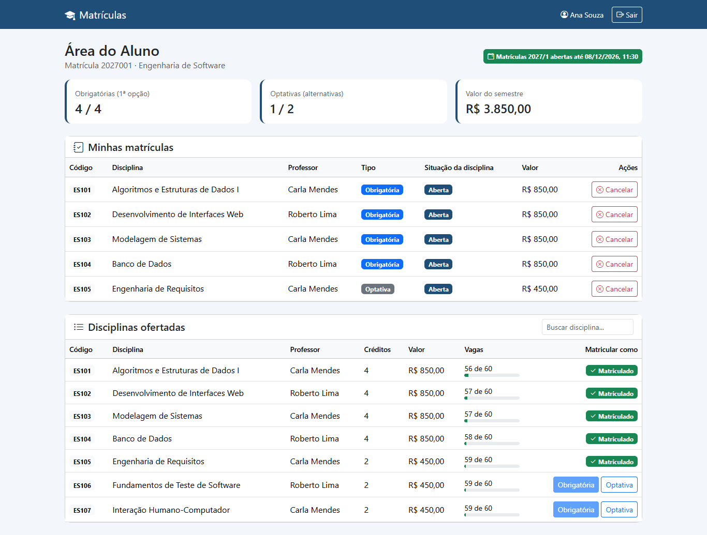
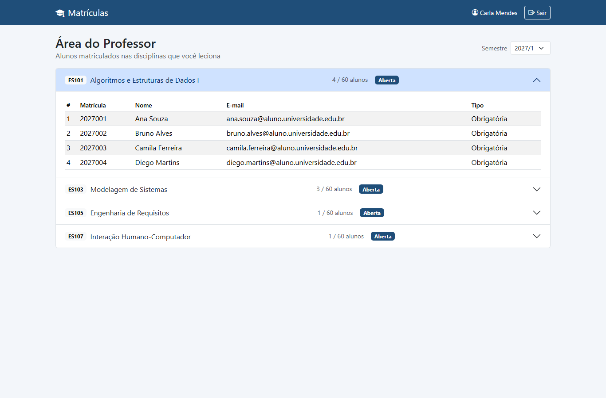
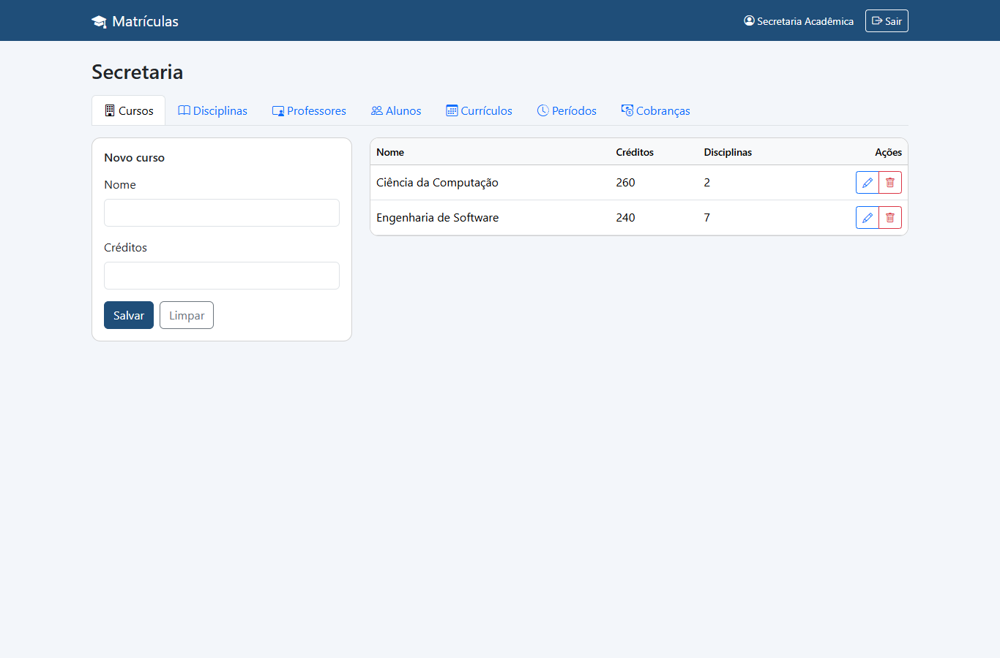
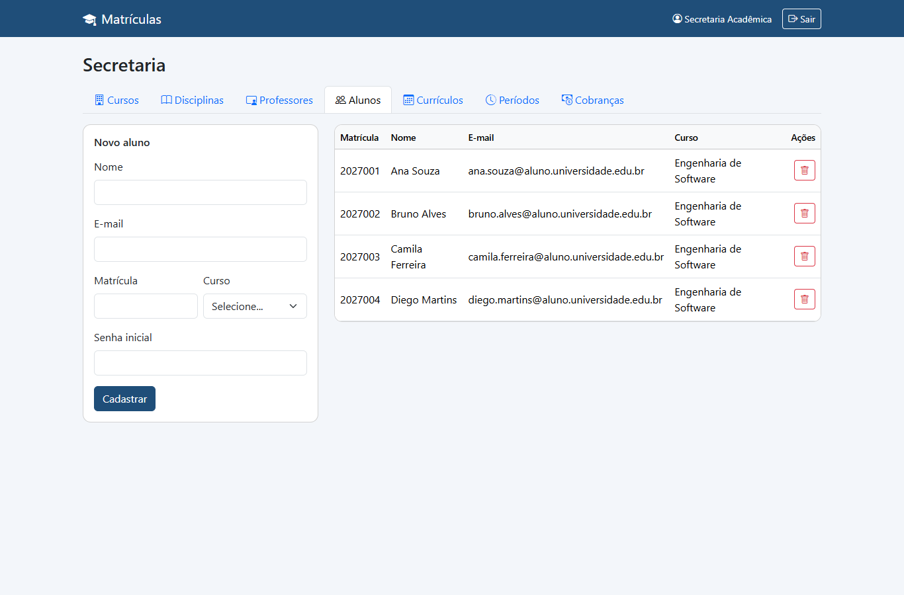
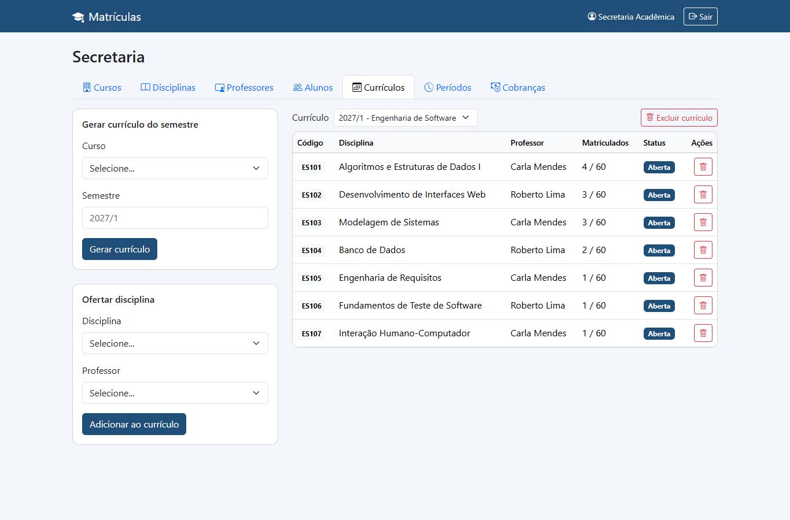
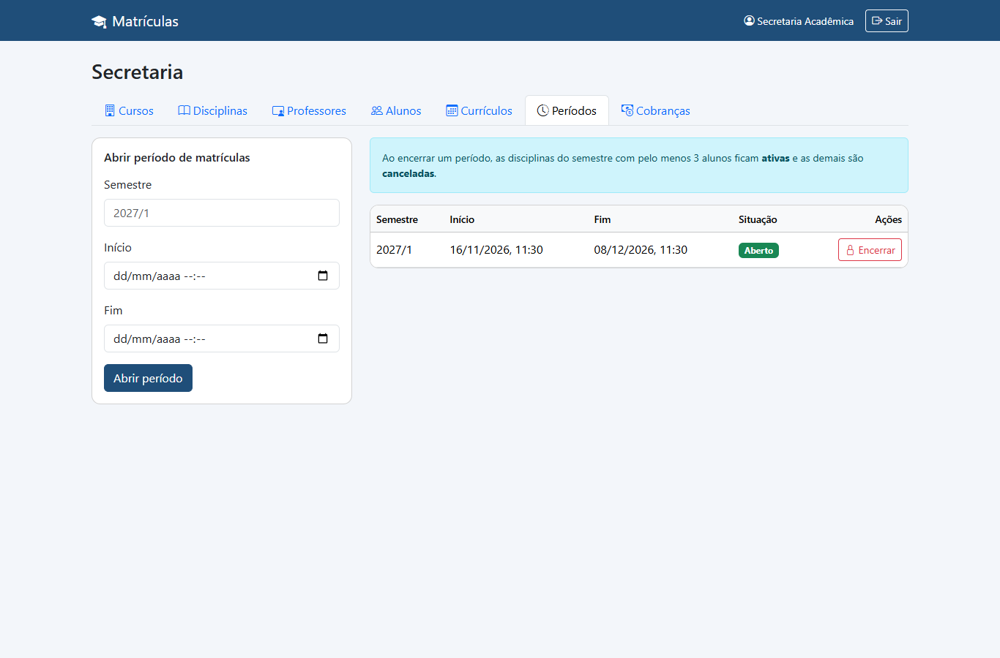
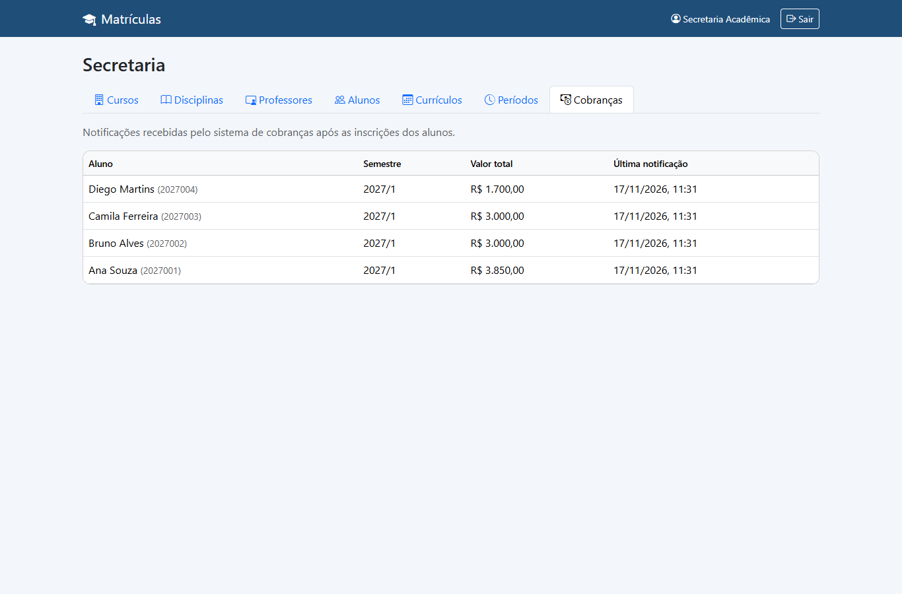

# 🎓 Sistema de Matrículas 👨‍💻

> [!NOTE]
> Sistema web para informatizar as matrículas de uma universidade: a secretaria monta o currículo do semestre, os alunos se matriculam nas disciplinas pela internet e os professores acompanham suas turmas. **Tudo em um só lugar, com regras de matrícula garantidas pelo próprio banco de dados.**

<table>
  <tr>
    <td width="800px">
      <div align="justify">
        O <b>Sistema de Matrículas</b> é o projeto do <b>Laboratório 03</b> da disciplina <i>Desenvolvimento de Interfaces Web (DIW)</i> do curso de Engenharia de Software da PUC Minas. A aplicação foi construída com <b>HTML5, CSS3 e JavaScript</b>, interface em <b>Bootstrap 5</b> e <b>Supabase</b> (PostgreSQL + Supabase Auth) como banco de dados e autenticação, acessado pela biblioteca <i>supabase-js</i>. Alunos se matriculam em até <b>4 disciplinas obrigatórias</b> e <b>2 optativas</b> durante o período de matrículas, cada disciplina aceita no máximo <b>60 alunos</b> e só fica ativa com pelo menos <b>3 inscritos</b>. A cada inscrição, o <b>sistema de cobranças</b> é notificado.
      </div>
    </td>
    <td>
      <div>
        
      </div>
    </td>
  </tr>
</table>

---

## 🚧 Status do Projeto

[](https://github.com/davicampolina/lab03-sistema-de-matriculas/releases)         

---

## 📚 Índice
- [Links Úteis](#-links-úteis)
- [Sobre o Projeto](#-sobre-o-projeto)
- [Funcionalidades Principais](#-funcionalidades-principais)
- [Modelo de Análise](#-modelo-de-análise)
  - [Diagrama de Casos de Uso](#diagrama-de-casos-de-uso)
  - [Histórias de Usuário](#histórias-de-usuário)
- [Tecnologias Utilizadas](#-tecnologias-utilizadas)
- [Arquitetura](#-arquitetura)
  - [Diagramas](#diagramas)
  - [Histórico dos modelos UML](#histórico-dos-modelos-uml)
- [Instalação e Execução](#-instalação-e-execução)
  - [Pré-requisitos](#pré-requisitos)
  - [Configuração do Supabase](#-configuração-do-supabase)
  - [Variáveis de Ambiente](#-variáveis-de-ambiente)
  - [Como Executar a Aplicação](#-como-executar-a-aplicação)
- [Deploy](#-deploy)
- [Estrutura de Pastas](#-estrutura-de-pastas)
- [Demonstração](#-demonstração)
- [Testes](#-testes)
- [Documentações utilizadas](#-documentações-utilizadas)
- [Autores](#-autores)
- [Contribuição](#-contribuição)
- [Agradecimentos](#-agradecimentos)
- [Licença](#-licença)

---

## 🔗 Links Úteis
* 💻 **Repositório:** [github.com/davicampolina/lab03-sistema-de-matriculas](https://github.com/davicampolina/lab03-sistema-de-matriculas)
  > 📦 **Descrição:** Código-fonte, scripts do banco e modelos UML (todas as versões).
* 📖 **Documentação:** [Diagramas UML](docs/diagramas) | [Scripts do banco](supabase)
  > 📚 **Descrição:** Fontes PlantUML dos diagramas (v1 e v2) e scripts SQL de criação do banco no Supabase.

---

## 📝 Sobre o Projeto

Uma universidade pretende informatizar seu sistema de matrículas. A secretaria gera o currículo de cada semestre e mantém as informações sobre cursos, disciplinas, professores e alunos. Cada curso tem um nome, um número de créditos e é constituído por diversas disciplinas.

Durante o **período de matrículas**, o aluno acessa o sistema para se matricular em até **4 disciplinas como 1ª opção (obrigatórias)** e em mais **2 alternativas (optativas)**, podendo também cancelar matrículas feitas anteriormente. Uma disciplina só fica **ativa** (só ocorre no semestre seguinte) se, ao final do período, tiver pelo menos **3 alunos** matriculados; caso contrário, é **cancelada**. O número máximo de alunos por disciplina é **60** e, quando atingido, as inscrições para ela são encerradas.

Após o aluno se inscrever, o **sistema de cobranças** é notificado para que ele seja cobrado pelas disciplinas do semestre. Os **professores** consultam os alunos matriculados em cada disciplina e **todos os usuários** acessam o sistema com e-mail e senha.

O projeto tem contexto **acadêmico** e foi desenvolvido seguindo o processo proposto no laboratório: modelo de análise, projeto estrutural, implementação do protótipo e correção dos diagramas.

---

## ✨ Funcionalidades Principais

- 🔐 **Autenticação:** login com e-mail e senha pelo Supabase Auth, com redirecionamento para a área de cada perfil (aluno, professor ou secretaria).
- 📝 **Matrícula online:** o aluno escolhe as disciplinas ofertadas para o seu curso como obrigatória ou optativa, vê as vagas restantes e cancela matrículas enquanto o período estiver aberto.
- 🚦 **Regras de negócio garantidas no banco:** limite de 4 obrigatórias + 2 optativas, máximo de 60 alunos por disciplina e matrícula apenas dentro do período (validadas no JavaScript e em um *trigger* no PostgreSQL).
- 🗂️ **Gestão acadêmica:** a secretaria cadastra cursos, disciplinas, professores e alunos, gera o currículo do semestre e oferta disciplinas com seus professores.
- ⏱️ **Períodos de matrícula:** abertura com data de início e fim e encerramento, que ativa as disciplinas com 3 ou mais alunos e cancela as demais.
- 💰 **Integração com cobranças:** a cada matrícula ou cancelamento o sistema de cobranças é notificado e recalcula o valor do semestre do aluno.
- 👩‍🏫 **Área do professor:** lista os alunos matriculados em cada disciplina que leciona, por semestre.
- 🛡️ **Segurança por perfil:** políticas RLS (*Row Level Security*) no Supabase impedem que um usuário acesse ou altere dados de outro perfil.

---

## 📋 Modelo de Análise

### Diagrama de Casos de Uso


Fonte: [`docs/diagramas/v2/casos-de-uso.puml`](docs/diagramas/v2/casos-de-uso.puml) — versão inicial em [`docs/diagramas/v1/casos-de-uso.puml`](docs/diagramas/v1/casos-de-uso.puml).

### Histórias de Usuário

#### Todos os usuários

**US01 – Efetuar login**
> Como **usuário do sistema** (aluno, professor ou secretaria), eu quero **entrar com meu e-mail e senha**, para **acessar somente as funcionalidades do meu perfil**.

Critérios de aceitação:
- O login é validado pelo Supabase Auth.
- Após o login, o usuário é direcionado para a página do seu perfil.
- Credenciais inválidas exibem uma mensagem de erro.
- O usuário pode sair do sistema (logout) a qualquer momento.

#### Aluno

**US02 – Matricular-se em disciplina**
> Como **aluno**, eu quero **me matricular nas disciplinas ofertadas no semestre**, escolhendo se cada uma é de 1ª opção (obrigatória) ou alternativa (optativa), para **montar minha grade do próximo semestre**.

Critérios de aceitação:
- A matrícula só é permitida durante um período de matrículas aberto.
- O aluno pode ter no máximo 4 matrículas obrigatórias e 2 optativas por semestre.
- Não é possível se matricular em uma disciplina que já atingiu 60 alunos.
- Não é possível se matricular duas vezes na mesma disciplina.

**US03 – Cancelar matrícula**
> Como **aluno**, eu quero **cancelar uma matrícula feita anteriormente**, para **ajustar minha grade enquanto o período de matrículas estiver aberto**.

Critérios de aceitação:
- O cancelamento só é permitido durante o período de matrículas.
- A vaga liberada volta a ficar disponível para outros alunos.

**US04 – Consultar minhas matrículas**
> Como **aluno**, eu quero **ver as disciplinas em que estou matriculado e o valor do semestre**, para **acompanhar minha grade e minha cobrança**.

**US05 – Notificar o sistema de cobranças**
> Como **aluno**, eu quero que **o sistema de cobranças seja avisado sempre que eu me inscrever ou cancelar uma disciplina**, para **ser cobrado corretamente pelas disciplinas do semestre**.

Critérios de aceitação:
- A cobrança do semestre é atualizada com a soma do valor das disciplinas em que o aluno está matriculado.
- Disciplinas canceladas no encerramento do período deixam de ser cobradas.

#### Professor

**US06 – Consultar alunos matriculados**
> Como **professor**, eu quero **ver a lista de alunos matriculados em cada disciplina que leciono**, para **me preparar para as turmas do semestre**.

Critérios de aceitação:
- O professor visualiza apenas as disciplinas que leciona.
- A lista mostra nome, matrícula e e-mail de cada aluno.

#### Secretaria

**US07 – Gerar currículo do semestre**
> Como **secretaria**, eu quero **gerar o currículo de cada semestre**, definindo quais disciplinas serão ofertadas e qual professor ministrará cada uma, para **disponibilizá-las para matrícula**.

**US08 – Manter cursos**
> Como **secretaria**, eu quero **cadastrar, editar e excluir cursos** (nome e número de créditos), para **manter o catálogo da universidade atualizado**.

**US09 – Manter disciplinas**
> Como **secretaria**, eu quero **cadastrar, editar e excluir disciplinas** de cada curso, para **compor os currículos semestrais**.

**US10 – Manter professores**
> Como **secretaria**, eu quero **cadastrar professores com login e senha**, para **que possam acessar o sistema**.

**US11 – Manter alunos**
> Como **secretaria**, eu quero **cadastrar alunos com matrícula, curso, login e senha**, para **que possam se matricular nas disciplinas**.

**US12 – Abrir período de matrículas**
> Como **secretaria**, eu quero **definir as datas de início e fim do período de matrículas de um semestre**, para **controlar quando os alunos podem se matricular ou cancelar matrículas**.

**US13 – Encerrar período de matrículas**
> Como **secretaria**, eu quero **encerrar o período de matrículas**, para que **as disciplinas com pelo menos 3 alunos fiquem ativas e as demais sejam canceladas**.

Critérios de aceitação:
- Disciplinas com 3 ou mais alunos passam para o status **ATIVA**.
- Disciplinas com menos de 3 alunos passam para o status **CANCELADA**.
- Após o encerramento, não é mais possível se matricular ou cancelar matrículas naquele semestre.

**US14 – Consultar cobranças**
> Como **secretaria**, eu quero **ver as notificações enviadas ao sistema de cobranças**, para **conferir o valor que cada aluno pagará no semestre**.

---

## 🛠 Tecnologias Utilizadas

### 💻 Front-end

* **Estrutura e lógica:** HTML5, CSS3 e JavaScript (ES Modules, sem etapa de build)
* **Interface:** Bootstrap 5.3.3 e Bootstrap Icons 1.11.3 (via CDN)

### 🖥️ Back-end (BaaS)

* **Banco de Dados:** Supabase (PostgreSQL)
* **Autenticação:** Supabase Auth (e-mail e senha)
* **Acesso aos dados:** biblioteca supabase-js 2.45.4 (via CDN)
* **Segurança:** Row Level Security (RLS), *trigger* de validação de matrícula e função `registrar_cobranca`

### ⚙️ Infraestrutura

* **Hospedagem do front-end:** qualquer servidor de arquivos estáticos (GitHub Pages, Vercel, Netlify)
* **Modelagem:** PlantUML

---

## 🏗 Arquitetura

O sistema é uma aplicação **front-end estática** que conversa diretamente com o **Supabase**. O código JavaScript é organizado em camadas, espelhando o diagrama de classes:

- **Páginas (`*.html`)**: estrutura e layout com Bootstrap. Cada perfil tem sua página (`aluno.html`, `professor.html`, `secretaria.html`) e o login fica em `index.html`.
- **Controladores (`js/pages`)**: tratam os eventos da tela, chamam os modelos e renderizam os dados.
- **Modelos (`js/models`)**: classes do domínio (`Aluno`, `Professor`, `Secretaria`, `Curso`, `Disciplina`, `Curriculo`, `Oferta`, `Matricula`, `PeriodoMatricula`, `Cobranca`) com atributos, regras de negócio e persistência no Supabase.
- **Serviços (`js/services`)**: `AuthService` (login, sessão e criação de contas) e `SistemaCobrancas` (integração com o sistema de cobranças).
- **Banco (`supabase/`)**: tabelas, *view* `ofertas_detalhadas`, *trigger* `validar_matricula`, função `registrar_cobranca` e políticas RLS.

**Decisões importantes:**
- As regras de matrícula são verificadas **no JavaScript** (para dar retorno rápido ao usuário) e **no banco** (para que não possam ser burladas e para tratar matrículas simultâneas na última vaga).
- A disciplina ofertada em um semestre foi modelada como a classe **`Oferta`**, que liga `Curriculo`, `Disciplina` e `Professor` e guarda o status (aberta, ativa ou cancelada) e a quantidade de alunos. Assim a mesma disciplina pode ser ofertada em vários semestres.
- A **chave anônima** do Supabase fica no front-end; o que protege os dados são as políticas RLS por perfil.
- A secretaria cria as contas de alunos e professores com um cliente Supabase sem sessão persistida, para não perder o próprio login.

### Diagramas

| Diagrama de Arquitetura | Diagrama de Classes (v2) |
| :---: | :---: |
|  |  |
| [`arquitetura.puml`](docs/diagramas/v2/arquitetura.puml) | [`classes.puml`](docs/diagramas/v2/classes.puml) |

### Histórico dos modelos UML

Todas as versões dos diagramas ficam no repositório:

| Versão | Etapa | Arquivos |
| :---: | :--- | :--- |
| **v1** | Modelo de análise e projeto estrutural | [`casos-de-uso.puml`](docs/diagramas/v1/casos-de-uso.puml), [`classes.puml`](docs/diagramas/v1/classes.puml) |
| **v2** | Correção após a implementação | [`casos-de-uso.puml`](docs/diagramas/v2/casos-de-uso.puml), [`classes.puml`](docs/diagramas/v2/classes.puml), [`arquitetura.puml`](docs/diagramas/v2/arquitetura.puml) |

**Principais modificações da v1 para a v2:**
- Os métodos `login`, `logout` e `usuarioAtual` saíram de `Usuario` e foram para o novo serviço **`AuthService`**, evitando dependência circular entre a superclasse e suas subclasses. `Usuario` ganhou o método polimórfico `paginaInicial()`.
- `Secretaria` ganhou `removerUsuario()` e o encerramento do período passou a notificar o sistema de cobranças sobre os alunos de disciplinas canceladas.
- `Oferta` ganhou o atributo `semestre` e os métodos `listarAlunos()` e de consulta (`listarPorCurriculo`, `listarPorSemestre`, `listarPorProfessor`).
- `Curriculo` ganhou `carregarOfertas()` e `excluir()`; `PeriodoMatricula` ganhou `situacao()`, `listar()` e `buscarPorSemestre()`; `Matricula` ganhou `listarPorAluno()`.
- `Aluno` e `Professor` ganharam `listar()` para a tela da secretaria e `SistemaCobrancas` ganhou `listar()`.
- No diagrama de casos de uso foram incluídos o ator generalizado **Usuário**, os casos *Consultar disciplinas ofertadas*, *Verificar período de matrículas aberto*, *Ofertar disciplina no currículo*, *Consultar cobranças* e *Efetuar logout*.
- Foi criado o **diagrama de arquitetura**.

---

## 🔧 Instalação e Execução

### Pré-requisitos

* **Conta no [Supabase](https://supabase.com/)** (plano gratuito)
* **Navegador** atualizado (Chrome, Edge ou Firefox)
* **Servidor de arquivos estáticos** para rodar localmente, por exemplo:
  * extensão **Live Server** do VS Code, ou
  * **Node.js** (para usar `npx serve`), ou
  * **Python 3** (para usar `python -m http.server`)

> [!IMPORTANT]
> Os scripts usam **ES Modules**, então a aplicação precisa ser aberta por um servidor (`http://localhost`) e não diretamente pelo arquivo (`file://`).

---

### 🗄️ Configuração do Supabase

1. Crie um novo projeto no Supabase.
2. Em **SQL Editor**, execute o conteúdo de [`supabase/schema.sql`](supabase/schema.sql). Ele cria as tabelas, a *view*, o *trigger*, a função de cobrança e as políticas RLS.
3. Em **Authentication > Providers > Email**, desative a opção **Confirm email** (as contas são criadas pela secretaria e precisam entrar sem confirmação por e-mail).
4. Em **Authentication > Users > Add user**, crie o usuário da secretaria marcando **Auto Confirm User**.
5. No **SQL Editor**, execute [`supabase/seed.sql`](supabase/seed.sql) trocando o e-mail pelo da secretaria criada. Ele cadastra o perfil da secretaria e alguns cursos e disciplinas de exemplo.

---

### 🔑 Variáveis de Ambiente

Como o projeto não tem etapa de build, as configurações ficam no arquivo [`js/config.js`](js/config.js). Copie os valores em **Project Settings > API** do Supabase:

| Variável | Descrição | Exemplo |
| :--- | :--- | :--- |
| `SUPABASE_URL` | URL do projeto Supabase. | `https://abcdefgh.supabase.co` |
| `SUPABASE_ANON_KEY` | Chave pública (*anon*) do projeto. | `eyJhbGciOiJIUzI1NiIsInR5cCI6...` |

```js
// js/config.js
export const SUPABASE_URL = 'https://abcdefgh.supabase.co';
export const SUPABASE_ANON_KEY = 'eyJhbGciOiJIUzI1NiIsInR5cCI6...';
```

> [!WARNING]
> Nunca coloque a chave **service_role** no front-end. Apenas a chave **anon** deve ser usada; a proteção dos dados é feita pelas políticas RLS.

---

### ⚡ Como Executar a Aplicação

1. **Clone o repositório:**

```bash
git clone https://github.com/davicampolina/lab03-sistema-de-matriculas.git
cd lab03-sistema-de-matriculas
```

2. **Configure o `js/config.js`** conforme a seção anterior.

3. **Inicie um servidor estático** na raiz do projeto (escolha uma opção):

```bash
# Node.js
npx serve .

# ou Python
python -m http.server 5500
```

Ou abra o `index.html` com o **Live Server** do VS Code.

4. Acesse **http://localhost:3000** (serve) ou **http://localhost:5500** (Python/Live Server) e entre com o usuário da secretaria.

**Fluxo sugerido para testar:**
1. Como **secretaria**: cadastre professores e alunos, gere o currículo do semestre (ex.: `2027/1`), oferte disciplinas e abra o período de matrículas.
2. Como **aluno**: matricule-se em disciplinas obrigatórias e optativas e acompanhe o valor do semestre.
3. Como **professor**: veja os alunos matriculados nas suas disciplinas.
4. Como **secretaria**: encerre o período e veja quais disciplinas ficaram ativas ou canceladas e as cobranças registradas.

---

## 🚀 Deploy

Por ser um site estático, basta publicar os arquivos da raiz do repositório.

**GitHub Pages:**
1. Em **Settings > Pages**, selecione a branch `main` e a pasta `/ (root)`.
2. Aguarde a publicação e acesse `https://<usuario>.github.io/lab03-sistema-de-matriculas/`.

**Vercel / Netlify:** importe o repositório sem comando de build e com diretório de saída igual à raiz (`.`).

> 🔑 Em **Authentication > URL Configuration** do Supabase, cadastre a URL publicada como *Site URL*.

---

## 📂 Estrutura de Pastas

```
.
├── index.html                   # 🔐 Página de login.
├── aluno.html                   # 🎒 Área do aluno (matrículas).
├── professor.html               # 👩‍🏫 Área do professor (alunos por disciplina).
├── secretaria.html              # 🗂️ Área da secretaria (cadastros, currículos e períodos).
├── css/
│   └── style.css                # 🎨 Estilos complementares ao Bootstrap.
├── js/
│   ├── config.js                # 🔑 URL e chave anon do Supabase.
│   ├── supabaseClient.js        # 🔌 Cliente supabase-js e tratamento de erros.
│   ├── models/                  # 🧬 Classes do domínio (diagrama de classes).
│   │   ├── enums.js             #    Perfil, TipoMatricula, StatusMatricula, StatusOferta.
│   │   ├── Usuario.js           #    Superclasse dos usuários.
│   │   ├── Aluno.js
│   │   ├── Professor.js
│   │   ├── Secretaria.js
│   │   ├── Curso.js
│   │   ├── Disciplina.js
│   │   ├── Curriculo.js
│   │   ├── Oferta.js            #    Disciplina ofertada em um currículo semestral.
│   │   ├── Matricula.js
│   │   ├── PeriodoMatricula.js
│   │   └── Cobranca.js
│   ├── services/
│   │   ├── AuthService.js       # 🛡️ Login, sessão e criação de contas (Supabase Auth).
│   │   └── SistemaCobrancas.js  # 💰 Notificação ao sistema de cobranças.
│   ├── pages/                   # 🎮 Controladores de cada página.
│   │   ├── login.js
│   │   ├── aluno.js
│   │   ├── professor.js
│   │   └── secretaria.js
│   └── utils/
│       └── ui.js                # 🛠️ Alertas, modal de confirmação, formatação e proteção de rotas.
├── supabase/
│   ├── schema.sql               # 💾 Tabelas, view, trigger, função e políticas RLS.
│   └── seed.sql                 # 🌱 Secretaria inicial, cursos e disciplinas de exemplo.
├── docs/
│   ├── diagramas/
│   │   ├── v1/                  # 📐 Casos de uso e classes (versão inicial).
│   │   └── v2/                  # 📐 Casos de uso, classes e arquitetura (corrigidos).
│   └── img/
│       ├── logo.svg             # 🖼️ Logo do projeto.
│       └── telas/               # 📸 Capturas de tela do sistema.
├── LICENSE                      # ⚖️ Licença MIT.
└── README.md                    # 📘 Este documento.
```

---

## 🎥 Demonstração

### 🌐 Aplicação Web

Para melhor visualização, as telas principais estão organizadas lado a lado. Clique em uma imagem para ampliar.

| Tela | Captura de Tela |
| :---: | :---: |
| **Login** | **Área do Aluno** |
|  |  |
| **Área do Professor** | **Secretaria – Cursos** |
|  |  |
| **Secretaria – Alunos** | **Secretaria – Currículos** |
|  |  |
| **Secretaria – Períodos** | **Secretaria – Cobranças** |
|  |  |

- **Login:** entrada com e-mail e senha; redireciona para a área do perfil.
- **Área do Aluno:** situação do período, contadores de obrigatórias (x/4) e optativas (x/2), valor do semestre, matrículas com cancelamento e disciplinas ofertadas com as vagas restantes.
- **Área do Professor:** disciplinas do semestre com os alunos matriculados em cada uma.
- **Secretaria:** cadastros, geração do currículo semestral, períodos de matrícula e notificações enviadas ao sistema de cobranças.

---

## 🧪 Testes

Os testes foram feitos de forma manual, seguindo os critérios de aceitação das histórias de usuário:

| Cenário | Resultado esperado |
| :--- | :--- |
| Login com senha errada | Mensagem "E-mail ou senha inválidos." |
| Aluno acessa `secretaria.html` | Redirecionado para `aluno.html` |
| Matrícula fora do período | Bloqueada com aviso de período fechado |
| 5ª matrícula obrigatória ou 3ª optativa | Bloqueada com aviso de limite atingido |
| Matrícula em disciplina com 60 alunos | Exibe "Inscrições encerradas" e o banco rejeita a inserção |
| Matrícula ou cancelamento | Valor do semestre atualizado e cobrança registrada na aba Cobranças |
| Encerrar período com disciplina de 2 alunos | Disciplina fica **Cancelada** e sai da cobrança dos alunos |
| Encerrar período com disciplina de 3+ alunos | Disciplina fica **Ativa** |
| Professor abre sua área | Vê apenas as próprias disciplinas e seus alunos |

---

## 🔗 Documentações utilizadas

* 📖 **Interface:** [Documentação do **Bootstrap 5**](https://getbootstrap.com/docs/5.3/getting-started/introduction/)
* 📖 **Banco de dados:** [Documentação do **Supabase**](https://supabase.com/docs)
* 📖 **Biblioteca JavaScript:** [**supabase-js**](https://supabase.com/docs/reference/javascript/introduction)
* 📖 **Autenticação:** [**Supabase Auth**](https://supabase.com/docs/guides/auth)
* 📖 **Segurança:** [**Row Level Security**](https://supabase.com/docs/guides/database/postgres/row-level-security)
* 📖 **Modelagem:** [**PlantUML**](https://plantuml.com/)
* 📖 **Projetos de exemplo:** [Repositório da disciplina](https://github.com/joaopauloaramuni/desenvolvimento-de-interfaces-web)
* 📖 **Guia de Estilo:** [**Conventional Commits**](https://www.conventionalcommits.org/en/v1.0.0/)

---

## 👥 Autores

| 👤 Nome | 🖼️ Foto | :octocat: GitHub |
|---------|----------|-----------------|
| Davi Campolina Rocha | <div align="center"></div> | <div align="center"><a href="https://github.com/davicampolina"></a></div> |

---

## 🤝 Contribuição

1.  Faça um `fork` do projeto.
2.  Crie uma branch para sua feature (`git checkout -b feature/minha-feature`).
3.  Commit suas mudanças (`git commit -m 'feat: adiciona nova funcionalidade X'`). **(Utilize [Conventional Commits](https://www.conventionalcommits.org/en/v1.0.0/))**
4.  Faça o `push` para a branch (`git push origin feature/minha-feature`).
5.  Abra um **Pull Request (PR)**.

---

## 🙏 Agradecimentos

* [**Engenharia de Software PUC Minas**](https://www.instagram.com/engsoftwarepucminas/) - Pelo apoio institucional e pela estrutura acadêmica.
* [**Prof. Dr. João Paulo Aramuni**](https://github.com/joaopauloaramuni) - Pelos ensinamentos em **Desenvolvimento de Interfaces Web** e pelo template de README utilizado neste projeto.

---

## 📄 Licença

Este projeto é distribuído sob a **[Licença MIT](LICENSE)**.

---
